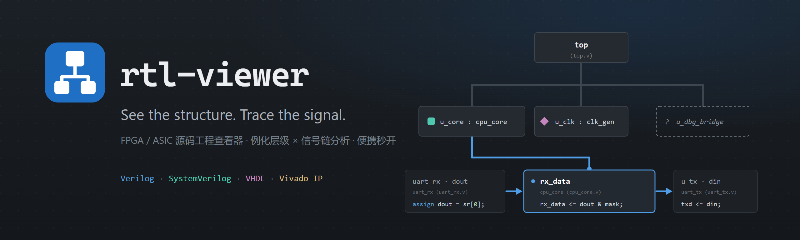
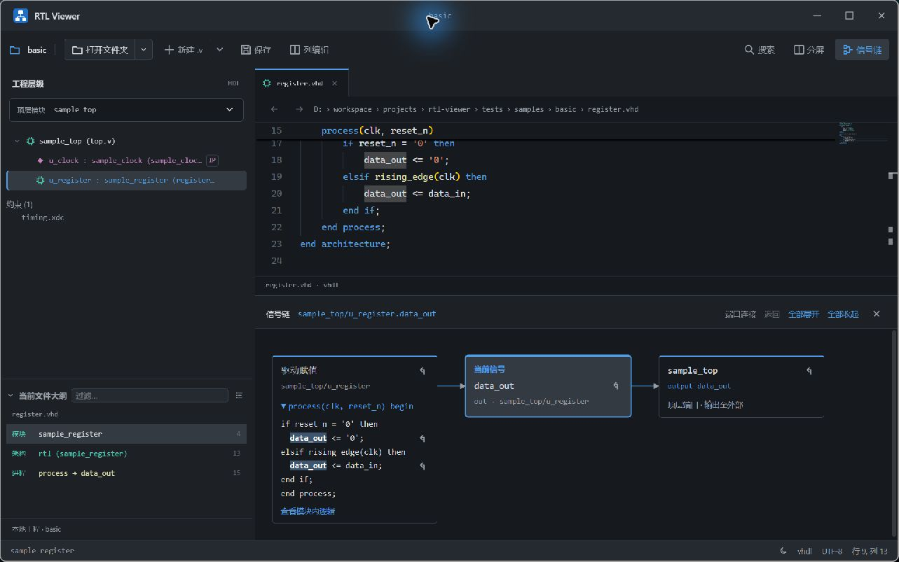

# rtl-viewer



面向 FPGA／ASIC 工程的轻量级 RTL 源码查看器。打开源码文件夹，即可浏览模块层级、跳转定义、追踪信号，并进行日常代码编辑。支持 Verilog、SystemVerilog 和 VHDL，提供 Windows 便携版。

## 核心功能

| 功能 | 用途 |
|---|---|
| 层级浏览 | 按例化关系展开工程，切换顶层，定位模块定义和例化位置；识别 Vivado IP 黑盒与约束文件 |
| 信号追踪 | 查看端口的来源与去向，展开模块内赋值和条件分支，从分析结果跳回源码 |
| 搜索导航 | 全工程搜索、当前文件大纲、定义跳转与独立的双视图导航历史 |
| 代码编辑 | 语法高亮、多标签、分屏、补全、列编辑、查找替换与未保存保护 |
| 编码兼容 | 自动识别 UTF-8、UTF-16 和 GBK，默认按原编码保存，支持手动选择编码 |
| 轻量运行 | 按需解析与分析，跳过 EDA 生成目录；单 exe 运行，支持深浅主题 |

## 界面预览



截图使用仓库内的 [独立样例](tests/samples/basic)：Verilog 顶层例化 VHDL 寄存器与 IP 黑盒，信号链展示输出端口的驱动赋值和顶层连接。

## 下载与快速开始

运行环境：Windows x64，并已安装 [Microsoft Edge WebView2 Runtime](https://developer.microsoft.com/microsoft-edge/webview2/)。下载便携版后，解压并运行 `rtl-viewer.exe`；Node、Rust 和 C++ 工具链仅用于源码构建。

在 [Windows CI](https://github.com/Natsume-kkk/rtl-viewer/actions/workflows/ci.yml) 中选择最近一次成功的 `main` 运行，从页面底部 Artifacts 下载 `rtl-viewer-windows-x64`。需要登录有仓库访问权限的 GitHub 账号；构建产物保留 7 天，过期后可手动运行工作流重新生成。

1. 点击“打开文件夹”或将源码文件夹拖入窗口；也可先打开仓库中的 `tests/samples/basic/` 熟悉界面。
2. 展开左侧层级树，点击模块查看定义；通过节点跳转按钮查看父模块中的例化位置。
3. 在源码信号上右键选择“追踪此信号”，查看来源、去向或模块内逻辑；点击卡片中的定位图标返回对应源码。

## 常用快捷键

| 操作 | 快捷键 |
|---|---|
| 打开工程文件夹／单文件 | `Ctrl+Alt+O`／`Ctrl+O` |
| 保存／另存为 | `Ctrl+S`／`Ctrl+Alt+S` |
| 跳转模块定义 | `F12`／`Ctrl+Click` |
| 全工程搜索／查找引用 | `Ctrl+Shift+F`／`Shift+F12` |
| 当前文件符号 | `Ctrl+Shift+O` |
| 导航后退／前进 | `Alt+←`／`Alt+→` |
| 在另一侧视图打开／切换视图焦点 | `Ctrl+Alt+V`／`F8` |

完整键位和操作说明见 [使用指南](docs/usage.md)。

## 分析边界

信号链基于源码进行静态分析，不执行综合、仿真或完整 HDL elaboration。展开分支用于阅读代码，不表示分支实际成立，也不提供周期值或时间波形。

IP 按黑盒处理。遇到不支持的语法、未知方向或无法确定的模块绑定时，界面会标明分析边界；未找到连接不能据此判定信号未使用。具体支持范围见 [信号链与分析边界](docs/usage.md#分析边界)。

## 开发与架构

技术栈：Tauri 2、Rust、TypeScript、Vite 和 Monaco Editor。

| 目录 | 职责 |
|---|---|
| `src/` | 前端界面、编辑器、HDL 解析、工程索引与信号分析 |
| `src-tauri/` | Rust 桌面后端、文件扫描、编码读写、系统对话框与应用配置 |
| `tests/` | 前端测试与独立 HDL 样例 |
| `scripts/` | 开发环境、构建、图标与截图工具 |
| `docs/` | 使用指南、开发指南与图片素材 |

`src/` 与 `src-tauri/` 组成同一个桌面应用，通过 `src/ipc.ts` 通信。配置好 [开发环境](docs/development.md#环境准备) 后，在项目根目录执行：

```powershell
npm ci
pwsh -NoProfile -ExecutionPolicy Bypass -File scripts/Build-Release.ps1
```

便携版输出到 `release/rtl-viewer.exe`。开发运行、测试、CI、私有夹具及生成目录说明见 [开发指南](docs/development.md)。

## 文档

- [使用指南](docs/usage.md)：工程浏览、信号追踪、编辑保存与完整快捷键。
- [开发指南](docs/development.md)：环境准备、构建测试、浏览器预览与目录职责。
- [独立分析样例](examples/computation/README.md)：源码运算图的离线交互实验。

## 仓库授权

本仓库为私有仓库，未添加开源许可证。
